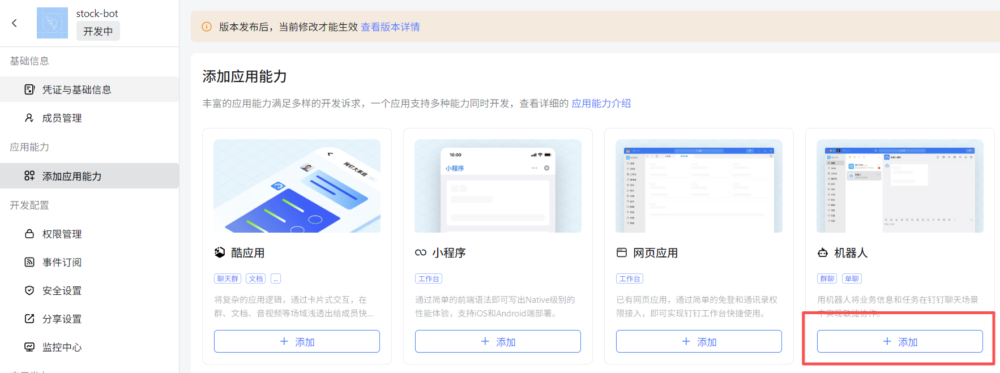
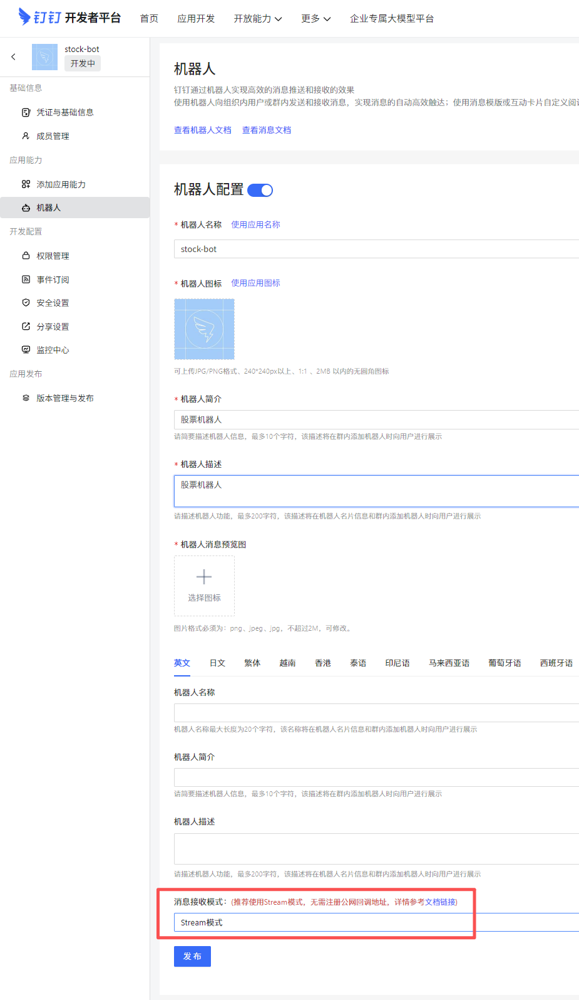
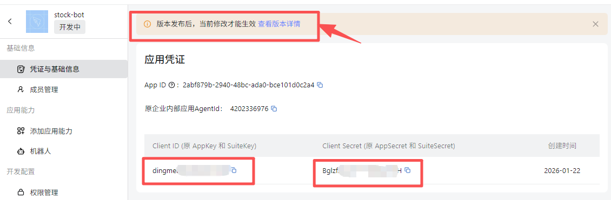
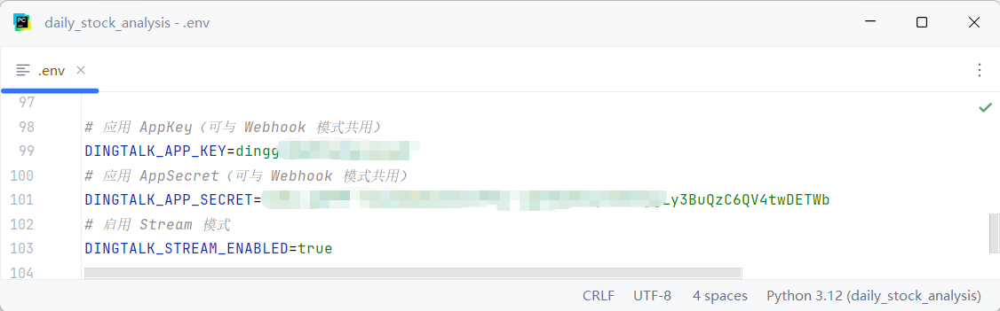
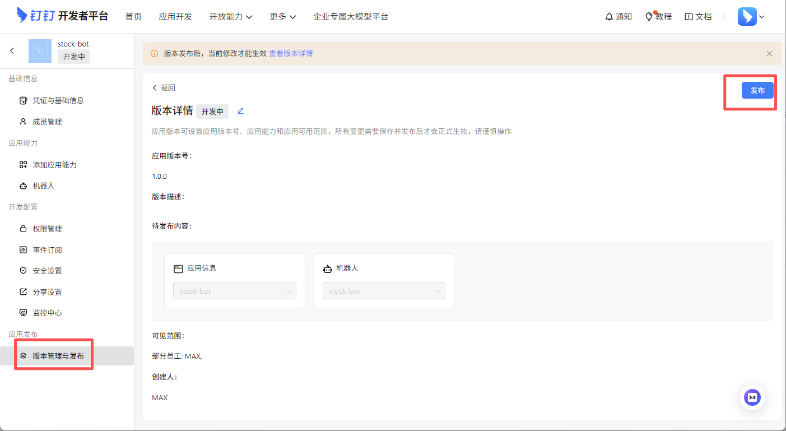
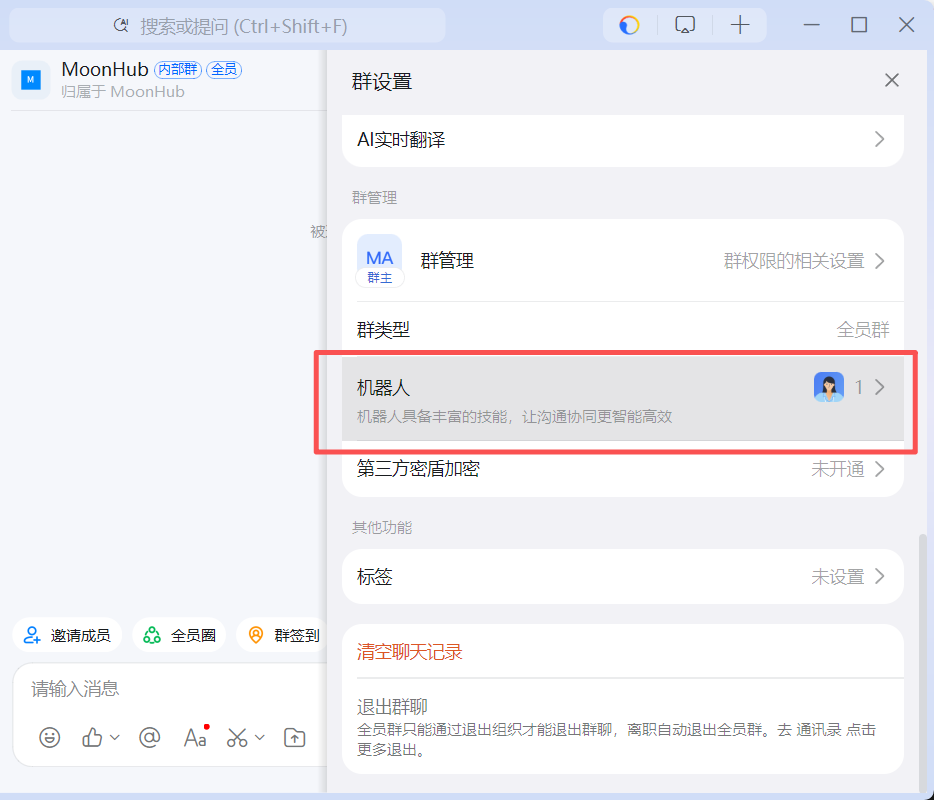
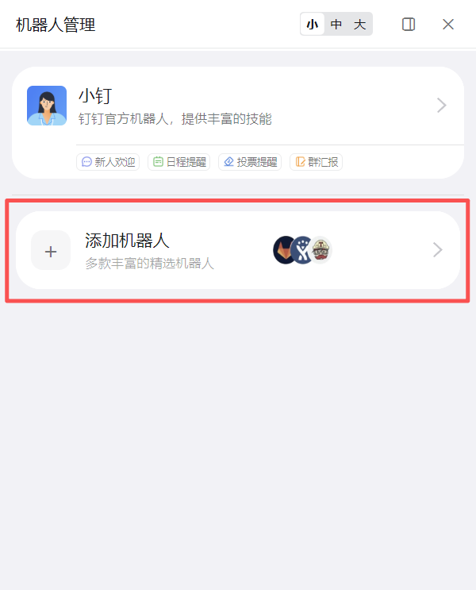
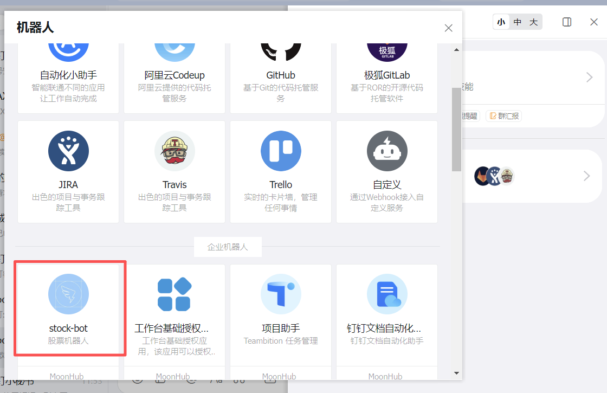
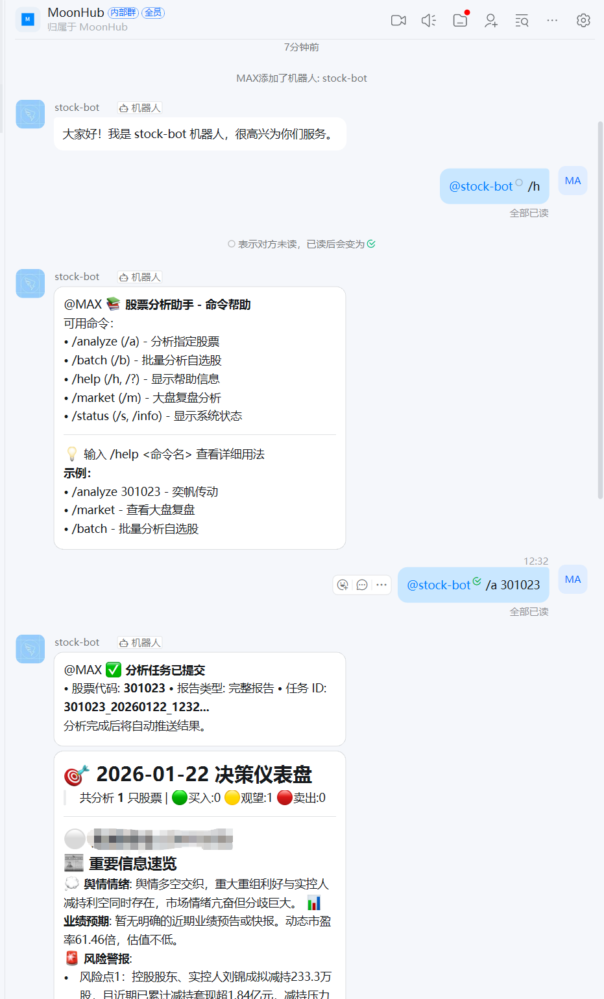

# DingTalk Enterprise Bot Configuration

## The DingTalk bot
Receiving messages with a DingTalk bot requires the enterprise bot capability:
https://open.dingtalk.com/document/dingstart/configure-the-robot-application

Message receiving comes in two flavors, `Http mode` (which needs a public address) and `Stream mode`. `Stream mode` is recommended.

Steps to create the application: https://open.dingtalk.com/document/dingstart/create-application

Application development > Internal enterprise application > DingTalk application > Create application > Add capability > Bot

### Add the bot

### Configure the bot to use Stream mode

### Get the application credentials

### Configure the DingTalk credentials
Put the DingTalk application credentials into the configuration file

### Publish the application

### Scroll down to see the enterprise bot that was added

### Test the bot commands

