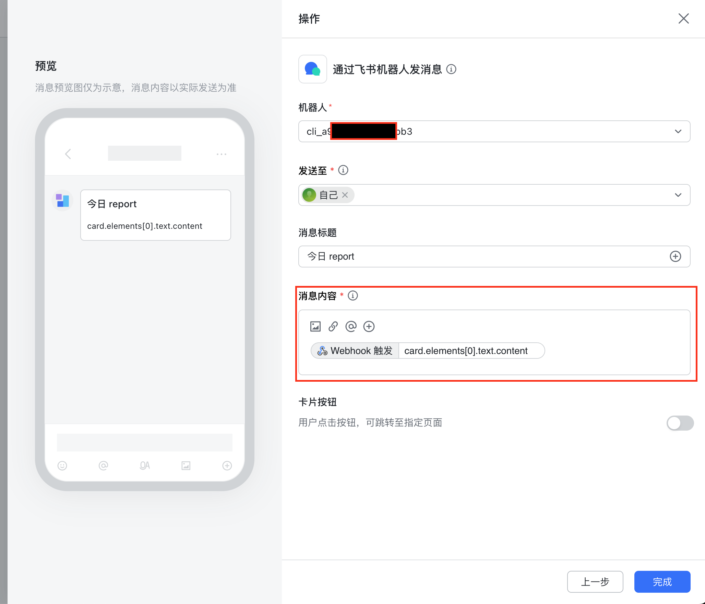
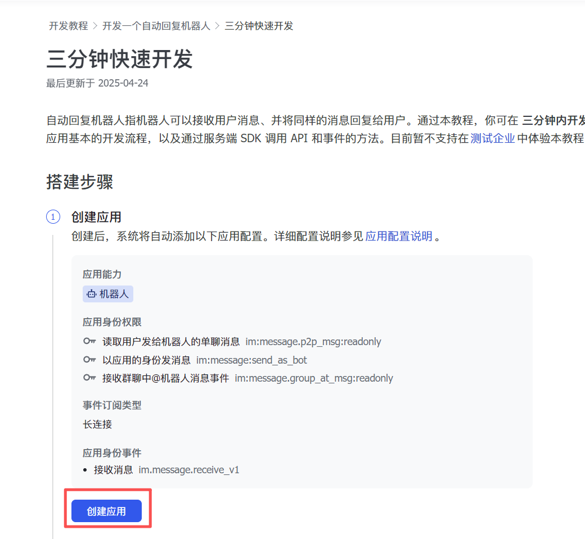
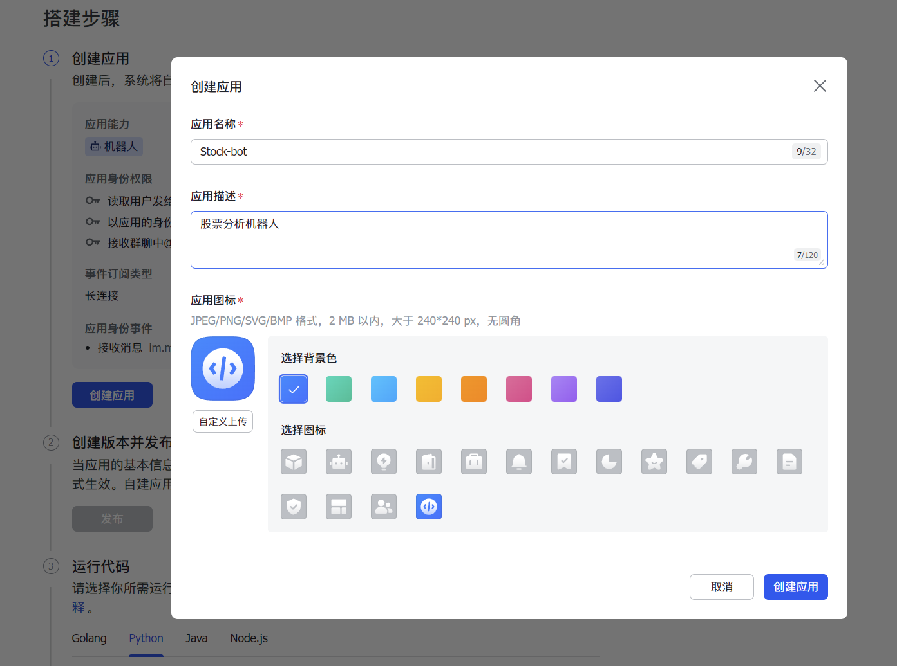
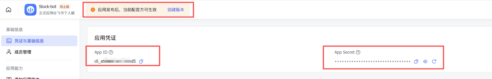
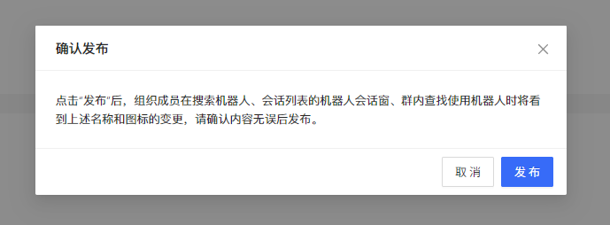
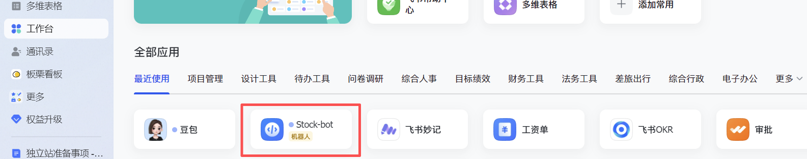
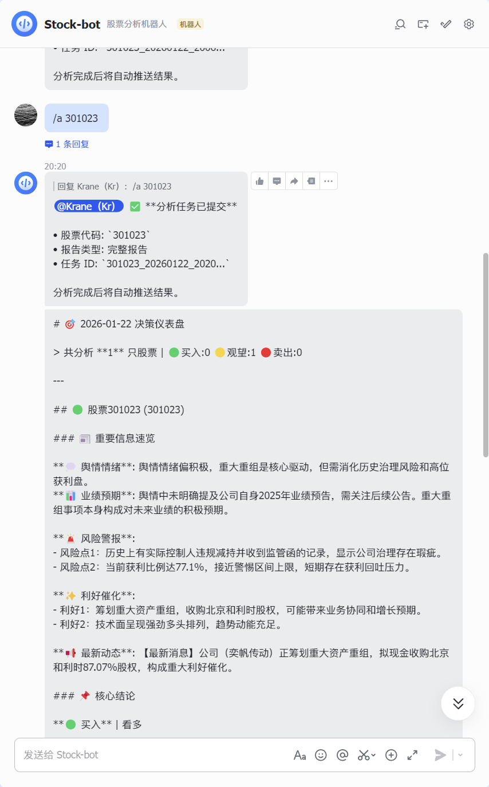

# Feishu Notification Configuration Guide

This page solves two common needs only:

1. Pushing analysis results to a Feishu group
2. Avoiding a mix-up between the Feishu application mode, App Bot outbound push, and the group-bot webhook mode

## Tell the two modes apart first

### Mode 1: group-bot webhook push

Use it when:
- You only want to push analysis reports to a Feishu group
- You do not need to handle Feishu message callbacks
- You do not need a Stream Bot

This is also the Feishu notification route this project recommends and the easiest to get working.

The variables to configure:

```env
FEISHU_WEBHOOK_URL=https://open.feishu.cn/open-apis/bot/v2/hook/your_hook_token
# Fill these in as needed
FEISHU_WEBHOOK_SECRET=your_sign_secret
FEISHU_WEBHOOK_KEYWORD=股票日报
```

### Mode 2: Feishu application / App Bot / Stream Bot / Docs

Use it when:
- You want a Feishu App Bot to push notifications to a specific group or user
- You want interactive Feishu application bot behavior
- You want Stream mode
- You want the Feishu Docs capability

The relevant variables:

```env
FEISHU_APP_ID=cli_xxx
FEISHU_APP_SECRET=xxx
# Required for App Bot outbound push
FEISHU_CHAT_ID=oc_xxx
# Set open_id for a direct message; a group chat defaults to chat_id
FEISHU_RECEIVE_ID_TYPE=chat_id
# Enable it only for event subscription / Stream Bot
FEISHU_STREAM_ENABLED=true
# Lark international must be set to lark; Feishu China stays feishu
FEISHU_DOMAIN=feishu
```

Notes:
- `FEISHU_APP_ID` / `FEISHU_APP_SECRET` do not enable group webhook push on their own
- For simple group notifications, configure `FEISHU_WEBHOOK_URL` first
- Without a webhook, App Bot outbound push requires `FEISHU_APP_ID`, `FEISHU_APP_SECRET`, and `FEISHU_CHAT_ID` together
- `FEISHU_STREAM_ENABLED` covers event subscription / Stream Bot only and takes no part in deciding whether outbound notification is configured
- `FEISHU_DOMAIN=lark` makes App Bot sending, the Stream long connection, and message replies all use `open.larksuite.com`; Feishu China keeps the default `feishu`
- If you are building an application bot or Stream Bot, jump to the original screenshot walkthrough kept at the end of this page
- The App Bot send path reuses `lark-oapi>=1.0.0`, which `requirements.txt` already carries, and a standard install uses `pip install -r requirements.txt`; see [Feishu message create OpenAPI](https://open.feishu.cn/document/server-docs/im-v1/message/create), [lark-oapi PyPI](https://pypi.org/project/lark-oapi/), and the [SDK repo](https://github.com/larksuite/oapi-sdk-python)

### File send mode (FEISHU_SEND_AS_FILE)

When enabled, the Feishu App Bot sends the report as a `.md` file instead of a text or card message:

```bash
FEISHU_SEND_AS_FILE=true
```

- **Required application permissions**: `im:message` (send messages) plus `im:file` (upload files)
- **Dependency version**: `lark-oapi>=1.0.0` must include the `im.v1.file.create` API (the file upload class)
- **Webhook mode**: falls back to sending the file content as text (webhooks do not support file upload)
- **Scope**: applies only to report pushes with `route_type="report"`; alerts, system notifications, and the rest are unaffected
- **GitHub Actions scheduled job**: already mapped through `.github/workflows/00-daily-analysis.yml`, so adding an identically named variable or secret under repo Settings -> Secrets and variables -> Actions enables it
- **How to configure**: through the `.env` file, a GitHub Actions secret/variable, or the web/desktop settings page

## The right way to configure a webhook push

### 1. Create a custom bot in the Feishu group

The path is usually:
- Group chat
- Group settings
- Group bots
- Add bot
- Custom bot

Copy the webhook URL the bot gives you afterwards.

Example:

```env
FEISHU_WEBHOOK_URL=https://open.feishu.cn/open-apis/bot/v2/hook/xxxxxxxx-xxxx-xxxx-xxxx-xxxxxxxxxxxx
```

### 2. Check the bot's security settings

A Feishu group bot commonly has three security options:

1. No security setting at all
2. A required keyword
3. Signature verification

If your bot has an extra security option enabled, the project side must match it, or Feishu rejects the request.

#### A keyword is required

Put the same keyword you configured in Feishu into:

```env
FEISHU_WEBHOOK_KEYWORD=股票日报
```

The project prepends that keyword to every Feishu message automatically, so you do not have to edit the report template by hand.

#### Signature verification is enabled

Put the secret Feishu shows into:

```env
FEISHU_WEBHOOK_SECRET=your_sign_secret
```

The project adds the `timestamp` and `sign` Feishu requires to every message automatically.

### 3. Start and verify

As long as `FEISHU_WEBHOOK_URL` is configured, notifications go out over the webhook channel.

If you also set:

```env
FEISHU_APP_ID=...
FEISHU_APP_SECRET=...
```

that does not affect the webhook push, but those variables cannot replace `FEISHU_WEBHOOK_URL`.

With no webhook configured, an App Bot outbound push works too:

```env
FEISHU_APP_ID=cli_xxx
FEISHU_APP_SECRET=xxx
FEISHU_CHAT_ID=oc_xxx
FEISHU_RECEIVE_ID_TYPE=chat_id
```

`FEISHU_STREAM_ENABLED` does not need to be on in that case; it is only for event subscription / Stream Bot.

### 4. Configure the webhook trigger in Feishu automation

If you consume this project's card messages in a Feishu automation flow, configure it as follows:

1. When creating the webhook trigger, set **Parameters** to the JSON below (`content` may keep a placeholder):

```json
{
  "msg_type": "interactive",
  "card": {
    "config": { "wide_screen_mode": true },
    "elements": [
      {
        "tag": "div",
        "text": {
          "tag": "lark_md",
          "content": "..."
        }
      }
    ],
    "header": {
      "title": {
        "tag": "plain_text",
        "content": "A股智能分析报告"
      }
    }
  }
}
```

2. In the **action / message content** section, do not type plain text; click the plus sign, choose **Webhook trigger**, and map it to:

`card.elements[0].text.content`



## The most common failure causes

### 1. Only `FEISHU_APP_ID` / `FEISHU_APP_SECRET` were set

Symptom:
- You believe Feishu is configured
- No group notification arrives at all

Cause:
- Those two variables are only application credentials. An outbound push also needs `FEISHU_CHAT_ID`, and a group webhook push needs `FEISHU_WEBHOOK_URL`

The fix:
- Simple group push: add `FEISHU_WEBHOOK_URL`
- App Bot outbound push: add `FEISHU_CHAT_ID`, and confirm the application can send messages and the bot is in the target group

### 2. The Feishu bot requires a keyword, but `FEISHU_WEBHOOK_KEYWORD` is not set locally

Symptom:
- Other apps can post
- This project cannot, or Feishu returns a validation failure

The fix:
- Copy the keyword from the Feishu bot's security settings verbatim into `FEISHU_WEBHOOK_KEYWORD`

### 3. The Feishu bot has signature verification on, but `FEISHU_WEBHOOK_SECRET` is not set locally

Symptom:
- The webhook URL looks fine
- Feishu returns a signature-related error

The fix:
- Put the bot secret into `FEISHU_WEBHOOK_SECRET`

### 4. The bot is not in the target group, or cannot post there

Check:
- Whether the bot really was added to the target group
- Whether a group administrator has restricted bot messages

### 5. An IP allowlist is configured on the Feishu side

If you run on a cloud server, in Docker, or in GitHub Actions, the egress IP may differ from your local one.

Check:
- Whether the Feishu bot has an IP allowlist enabled
- Whether the current runtime's egress IP is on that list

## The suggested minimal working configuration

### No extra security restriction

```env
FEISHU_WEBHOOK_URL=https://open.feishu.cn/open-apis/bot/v2/hook/your_hook_token
```

### With a required keyword

```env
FEISHU_WEBHOOK_URL=https://open.feishu.cn/open-apis/bot/v2/hook/your_hook_token
FEISHU_WEBHOOK_KEYWORD=股票日报
```

### With signature verification

```env
FEISHU_WEBHOOK_URL=https://open.feishu.cn/open-apis/bot/v2/hook/your_hook_token
FEISHU_WEBHOOK_SECRET=your_sign_secret
```

### With both a keyword and a signature

```env
FEISHU_WEBHOOK_URL=https://open.feishu.cn/open-apis/bot/v2/hook/your_hook_token
FEISHU_WEBHOOK_SECRET=your_sign_secret
FEISHU_WEBHOOK_KEYWORD=股票日报
```

## A suggested diagnostic order

1. Decide first whether you want a group webhook push or an application / Stream Bot
2. For a simple group push, make sure `FEISHU_WEBHOOK_URL` is configured
3. For an App Bot outbound push with no webhook, confirm all three of `FEISHU_APP_ID` / `FEISHU_APP_SECRET` / `FEISHU_CHAT_ID` are present
4. Go back to the Feishu bot's security settings and check whether a keyword or a signature is enabled
5. If one is, add `FEISHU_WEBHOOK_KEYWORD` / `FEISHU_WEBHOOK_SECRET` to match
6. Finally check that the bot is in the group, has permission, and passes any IP allowlist

## Appendix: the original application / Stream Bot screenshot walkthrough

If you are not doing a plain group webhook push but want to configure the Feishu application, a long-connection bot, or Docs, use the original screenshots below.

### 1. Create the application

https://open.feishu.cn/document/develop-an-echo-bot/introduction





### 2. Get the credentials



### 3. Publish the application



### 4. Open the application in Feishu



### 5. Message interaction


