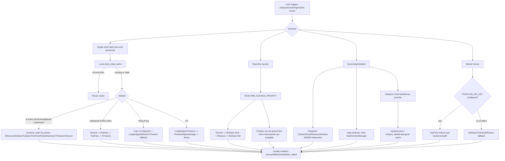
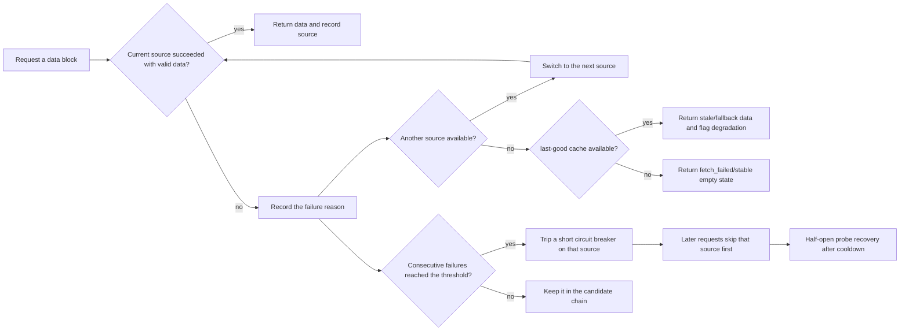
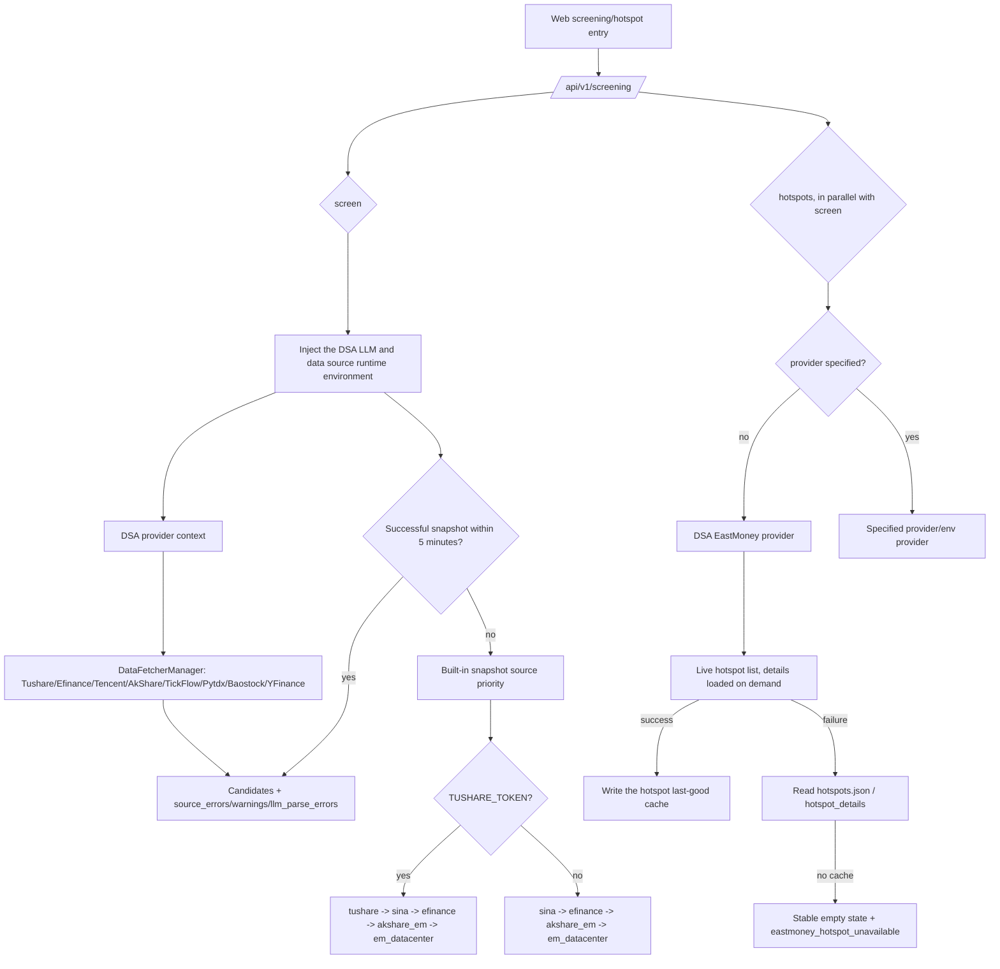

# Data source stability and failure handling

This document is for users, deployers, and maintainers. It explains how the data sources DSA integrates take part in analysis, screening, and market review, and how the system degrades when one fails.

The guiding principle is to use the sources the project has already integrated and verified, and to make the failure paths explicit. Adding external data sources belongs in a second stage, so the maintenance surface does not grow first.

## The one-line answer for users

A "data source failure" usually does not mean the system can only use one source. It normally means a free source is being rate-limited, an upstream API changed temporarily, the network is unstable, or the current market or instrument is unsupported. DSA already has multi-source fallback and tries the next source automatically per scenario. For more stability, configure at least one token-based source:

- A-share single stocks and screening: configure `TUSHARE_TOKEN` first, and keep AkShare / efinance / Tencent / TickFlow / Baostock / YFinance as fallbacks. Ordinary single-stock daily bars are ordered by the priority configuration.
- Registered A-share indices: always degrade Tencent -> AkShare -> TickFlow -> YFinance, ignoring the `*_PRIORITY` settings used for ordinary daily bars.
- A-share market review: with `TICKFLOW_API_KEY` configured, the indices and market breadth needed for review aggregation try TickFlow first and fall back to the existing free sources. This is a different entry point from the Tencent-first fixed chain used for single-instrument index daily bars.
- Hong Kong: with `FUTU_OPEND_HOST` configured, Futu can be the primary real-time and fundamental source. `FUTU_HK_REALTIME_SOURCE_PRIORITY` controls the Hong Kong real-time order, and Longbridge, AkShare, and YFinance remain fallbacks.
- US: with `LONGBRIDGE_*` configured, Longbridge is preferred and YFinance remains the real-time fallback. Finnhub and AlphaVantage only supplement fields after a primary source has returned a quote, or take part in the daily-bar chain; they cannot return a real-time quote independently when both Longbridge and YFinance fail.
- Hot themes: the screening hotspot implementation is modelled on AlphaSift, defaults to the EastMoney provider, and uses a local last-good cache to reduce the impact of a real-time API failure.

## Integrated data source matrix

| Scenario | Integrated sources | Default behaviour | Failure handling |
| --- | --- | --- | --- |
| A-share single-stock daily bars / technicals | efinance, Tencent, AkShare, Tushare, TickFlow, Pytdx, Baostock, YFinance | `DataFetcherManager` tries them by priority; with `TUSHARE_TOKEN` configured, Tushare joins the candidates automatically | After one source fails the next is tried; repeated failures trip a short circuit breaker on that source |
| Registered A-share index daily bars / technicals | Tencent, AkShare, TickFlow, YFinance | The 5 current `IndexRegistry` instruments always try Tencent -> AkShare -> TickFlow -> YFinance, ignoring the `*_PRIORITY` settings for ordinary daily bars | Unconfigured, tripped, erroring, or empty results all continue to the next source; when all fail an empty result is returned with an aggregated warning |
| A-share real-time quotes | Tencent, AkShare Sina, efinance, AkShare EM, Tushare | `REALTIME_SOURCE_PRIORITY` sets the order, defaulting to lightweight sources such as Tencent and Sina | A failing source records `fallback_from`, and the successful source still returns |
| A-share market review | TickFlow, AkShare, Tushare, efinance | With `TICKFLOW_API_KEY` configured, review aggregation tries TickFlow first for the main indices and market breadth; this is not the same as the single-instrument index daily-bar chain | Insufficient TickFlow permission or a failure falls back to the AkShare / Tushare / efinance chain |
| Screening snapshot | Tushare, Sina, efinance, AkShare EM, EastMoney Datacenter | With `TUSHARE_TOKEN`, `tushare` is placed into the snapshot priority automatically; otherwise the free-source chain is used | The screening engine maintains source health, and the status endpoint exposes snapshot and daily health |
| Screening daily-bar features | `DataFetcherManager` | The screening engine reuses the existing daily-bar and cache path first | Only after that path fails does it fall back to the engine's own daily source |
| Screening hot themes | EastMoney provider, the AlphaSift-inspired hotspot implementation, last-good cache | Without an explicit provider, the EastMoney provider is used | A real-time failure falls back to the hotspot cache; with no cache it returns a stable empty state and a readable error |
| Hong Kong | Futu, Longbridge, YFinance, AkShare, Tushare | With `FUTU_OPEND_HOST` configured, Futu is the primary real-time and fundamental source, tried in `FUTU_HK_REALTIME_SOURCE_PRIORITY` order | A Futu failure falls back to Longbridge / AkShare / YFinance; a Longbridge cooldown or failure continues to YFinance or another available source |
| US | Longbridge, YFinance, AkShare, Tushare, Finnhub, AlphaVantage, Stooq | With Longbridge credentials configured it joins the US daily-bar and real-time chain; YFinance remains the basic real-time fallback; Finnhub and AlphaVantage can supplement existing quote fields and join the daily-bar chain | A Longbridge cooldown or failure falls the real-time chain back to YFinance; when both fail, the supplementary sources are not disguised as a fallback that can return a quote on its own |

## Unified read-only data capability contract

Web and API expose `GET /api/v1/data/overview` and the equivalent alias `GET /api/v1/data/capabilities`, which present data-source capability, dataset quality, and scenario priority as one read-only structure for the home dashboard, the data centre, the stock detail page, the watchlist, and the screening page.

The first version of the contract reads only the configuration and the `DataFetcherManager` fetcher snapshot. It triggers no external quote requests and returns no raw secrets. The response has three layers:

- `providers`: each provider's `enabled`, `configured`, `status`, `markets`, `datasets`, precise `dataset_markets`, and non-sensitive warnings. `markets` and `datasets` are aggregate indexes only and must not be read as a Cartesian product. For example YFinance can serve A-share quotes, but A-share fundamentals always go through AkShare, so `dataset_markets.financial.snapshot` does not include `cn`. The Finnhub and AlphaVantage US quote handlers currently only supplement fields after Longbridge or YFinance has returned the primary quote, so they do not declare an independent `quote.realtime` route.
- `datasets`: the `status/source/fallback_from/stale/warnings` of `quote.realtime`, `kline.daily`, `index.daily`, `market.overview`, `financial.snapshot`, `news.events`, `strategy.screening`, `alert.monitor`, and `portfolio.account`. Among these, `quote.realtime`, `kline.daily`, `market.overview`, and `financial.snapshot` all aggregate market-level coverage, which avoids reporting one market's health as global availability. A-share real-time additionally splits the `cn` stock priority, the `cn.index.exchange` fixed index chain, and the `cn.index.csi` efinance-only chain; US real-time splits the dynamic `us` single-stock priority from the fixed YFinance-only `us.index` chain. Sub-source circuit breakers for AkShare Tencent/Sina/EM, the two AkShare HK sub-sources, and efinance stock/index sources, plus the daily-bar breaker, are evaluated before a provider-wide unknown verdict, which keeps the overview consistent with runtime skip behaviour. YFinance's Hong Kong real-time declaration matches its actual `.HK` execution path; without OpenD configured, the HK priority skips Futu exactly as the runtime does; US single-stock real-time also skips a Longbridge in connection cooldown based on current request availability, which makes YFinance the actual primary source rather than a pseudo-fallback. PyTDX declares no real-time capability it has not wired into the unified route, and YFinance index daily bars declare only the CN/US routes that can actually execute. Any dataset that is tried in runtime order stays `unknown` while the first priority source has not been probed and there is no more specific open-breaker evidence, rather than claiming a later source was already selected. `alert.monitor` is `ok` only when the switch is enabled and the current API process's scheduler has actually registered and is running `agent_event_monitor`; a disabled switch returns `agent_event_monitor_disabled`, and a scheduler that is not running returns `agent_event_monitor_not_running`.
- `priorities`: the current source order for `cn.realtime`, `hk.realtime`, `us.realtime`, `daily.generic`, `cn.index.daily`, `market.overview`, `screening.snapshot`, and `news.events`. Like the runtime, `daily.generic` first excludes fetchers that are unavailable for the current request or in connection cooldown, and does not record a skipped source as a fallback.
- `index.daily` additionally distinguishes `cn.exchange`, `cn.csi`, and `us` coverage: Shanghai and Shenzhen exchange indices use the fixed multi-source Tencent, AkShare, TickFlow, YFinance chain; CSI indices recognize only AkShare per the runtime contract; and US indices declare only YFinance, which is the one that currently accepts an index symbol. The Finnhub fetcher currently rejects index symbols, so it is not offered as a pseudo-fallback. Tushare declares no index daily-bar capability. CN and HK real-time both accept only source tokens that have a real handler at runtime, and Tushare's real-time capability is declared for A-shares only.

Here `unknown` means no runtime probe has run yet, `unconfigured` means required configuration is missing, and `degraded` means an earlier priority source is unavailable while a later one is still usable. Screening source health stays `unknown` on a cold start when both the success and failure counts are 0, so a source that has not been called yet is never marked `ok` prematurely. A later Data Center can append `last_success`, coverage, cooldown, and run history to the same structure, so each page does not have to maintain its own idea of data quality.

## Overall flow



## Failure and degradation



The current daily-bar breaker trips after 3 consecutive failures and cools down for about 5 minutes. Its purpose is not to disable a source permanently, but to stop one temporarily unavailable source from slowing an entire batch of analyses.

## Screening and hotspot flow



## Recommended configuration profiles

### Free mode

Suited to personal trials, relying on automatic fallback between free sources. The advantage is that no token is needed; the drawback is a higher chance of upstream rate limiting or a temporary API change.

```env
REALTIME_SOURCE_PRIORITY=tencent,akshare_sina,efinance,akshare_em
ENABLE_EASTMONEY_PATCH=true
```

### A-share stable mode

Suited to frequent screening, batch analysis, or serving others. Tushare improves the stability of ordinary A-share daily bars and snapshots; TickFlow can improve ordinary A-share daily bars, the fixed fallback for registered indices, real-time quotes, and market review (real-time quotes require adding it to `REALTIME_SOURCE_PRIORITY` explicitly); the free sources remain as a safety net.

```env
TUSHARE_TOKEN=your_tushare_token
TICKFLOW_API_KEY=your_tickflow_key

REALTIME_SOURCE_PRIORITY=tickflow,tushare,tencent,akshare_sina,efinance,akshare_em
SNAPSHOT_SOURCE_PRIORITY=tushare,sina,efinance,akshare_em,em_datacenter

# Screening runtime defaults; an explicit setting keeps your value
DAILY_FETCH_RETRIES=3
DAILY_FETCH_MAX_WORKERS=1
```

Note: TickFlow capabilities are tiered by plan. Insufficient permission or a failed request fails open to the existing free sources, so treating it as the single source for every market's quotes is not recommended.

### Hong Kong / US stable mode

Suited to Hong Kong and US portfolios, holdings, and single-stock analysis. Once configured, Longbridge takes priority in the Hong Kong and US paths, with YFinance, Finnhub, and AlphaVantage as the safety net.

```env
LONGBRIDGE_OAUTH_CLIENT_ID=your_client_id
LONGBRIDGE_OAUTH_TOKEN_CACHE_B64=your_token_cache_base64

FINNHUB_API_KEY=your_finnhub_key
ALPHAVANTAGE_API_KEY=your_alphavantage_key
```

If you still use legacy Longbridge credentials, these also work:

```env
LONGBRIDGE_APP_KEY=your_app_key
LONGBRIDGE_APP_SECRET=your_app_secret
LONGBRIDGE_ACCESS_TOKEN=your_access_token
```

## Suggested user-facing messages

When communicating externally, distinguish three cases:

| Case | Suggested message |
| --- | --- |
| One source failed but the fallback succeeded | A degraded data source was used this time; the analysis continues, and the report marks the source that actually succeeded. |
| Several sources failed but a cache exists | The real-time source is unavailable, so the last successful cache was used; the conclusion carries lower confidence. |
| All sources failed with no cache | Data is unavailable right now, please retry later. For ordinary A-shares check Tushare/TickFlow; for registered indices check Tencent/AkShare connectivity or configure TickFlow; for Hong Kong and US check Longbridge. |

Ordinary A-share daily bars use the `cn` health namespace, and the fixed chain for registered indices uses a separate `cn_index` namespace, so consecutive failures in one chain never trip the other. When an index source returns an empty result, the fallback continues and a diagnostic is recorded; if all four fail, an empty result and an empty source are returned. Ordinary stocks keep their existing final exception semantics.

### Report disclosure when news evidence is missing (implemented)

The report distinguishes news retrieval that **did not run** from retrieval that ran with **zero hits**, and renders the matching notice. These strings are the live report text, so they are shown here verbatim:

> ⚠️ 未配置搜索渠道，本次分析未纳入新闻面证据。

> ⚠️ 本次未获取到可用的新闻面数据，以下结论未纳入新闻维度证据。

This covers the dashboard, brief, single-stock, and daily-report rendering paths, plus historical Markdown, share images, and the Web report detail. Chinese, English, and Korean reports each use their own disclosure text. The decision is independent of the model output: even when the LLM emits `market_sentiment` or `hot_topics` according to the schema, a zero-hit retrieval still produces the notice, which avoids the combination of showing a model-generated sentiment judgement while hiding the absence of news evidence.

The decision is based on `AnalysisResult.news_result_count`:

| Value | Meaning | Notice shown |
| --- | --- | --- |
| `None` | Retrieval did not run (no search channel configured) | **Yes** - states explicitly that this analysis has no news evidence |
| `0` | Retrieval ran with zero hits (rate-limited sources, all failed, and so on) | **Yes** |
| `> 0` | News was retrieved normally | No |

New records persist that three-state value with the analysis result, which keeps live and historical reports consistent. An older record that did not save `news_result_count` has an unknown retrieval state; its historical display is left as-is and is never back-inferred as "no search channel configured".

## Possible product enhancements

1. A data-source doctor page: show each source's last success time, failure reason, breaker state, and next recovery probe time.
2. One-click recommended configuration: generate an `.env` snippet from the chosen market, for example "A-share stable mode", "Hong Kong/US stable mode", or "free mode".
3. A screening status panel: show snapshot and daily source health directly, so users can see whether Sina, efinance, AkShare, or Tushare is the problem.
4. A batch-job rate-limiting strategy: reduce concurrency automatically for free sources and prefer the local daily-bar cache, which reduces upstream rate limiting.
5. Optional commercial sources: only consider adding Twelve Data, Massive/Polygon, Nasdaq Data Link, and similar once Tushare, TickFlow, Longbridge, Finnhub, and AlphaVantage still cannot cover the requirement.

## Official resources

- Tushare: https://tushare.pro/document/2
- TickFlow: https://tickflow.org/
- AkShare: https://akshare.akfamily.xyz/
- Longbridge OpenAPI: https://open.longportapp.com/
- Finnhub API: https://finnhub.io/docs/api
- Alpha Vantage API: https://www.alphavantage.co/documentation/
