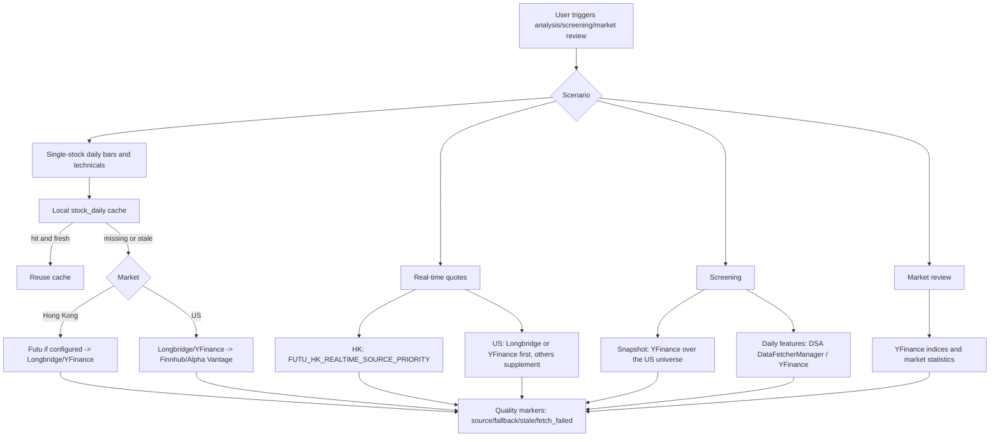
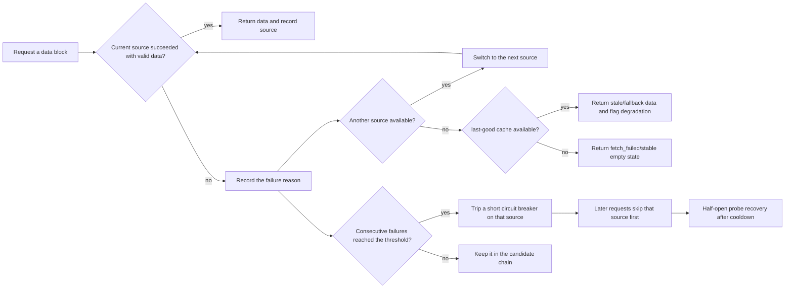
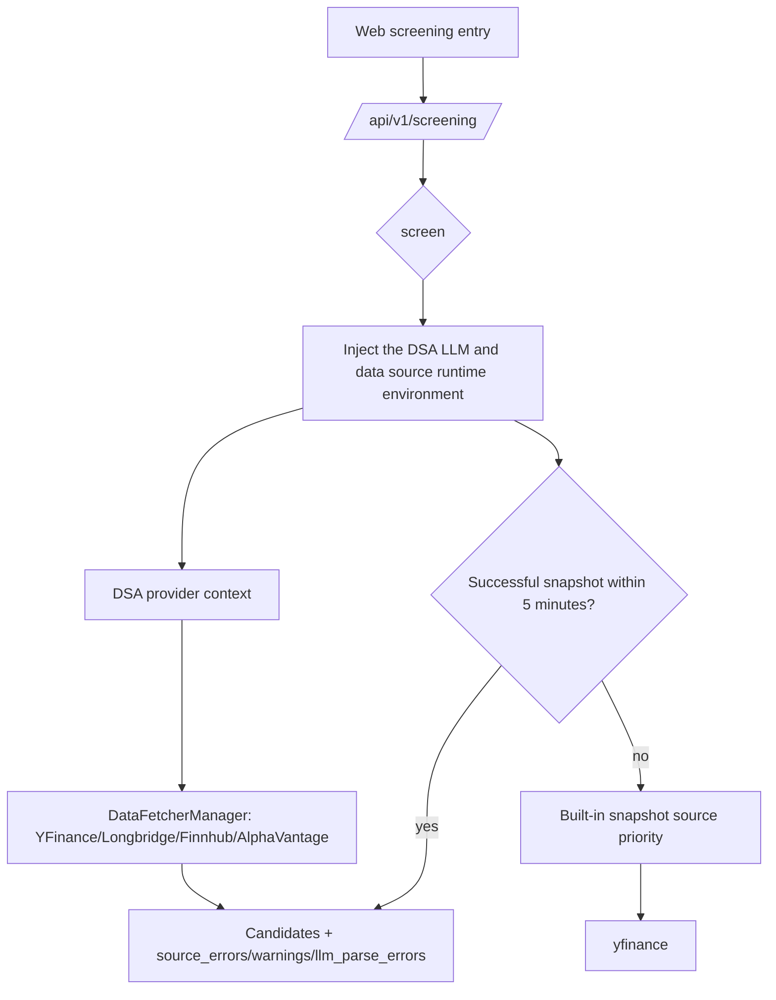

# Data source stability and failure handling

This document is for users, deployers, and maintainers. It explains how the data sources DSA integrates take part in analysis, screening, and market review, and how the system degrades when one fails.

The guiding principle is to use the sources the project has already integrated and verified, and to make the failure paths explicit. Adding external data sources belongs in a second stage, so the maintenance surface does not grow first.

DSA supports **US and Hong Kong** markets. Mainland China (A-share) data sources were removed; see [Market support](market-support.md).

## The one-line answer for users

A "data source failure" usually does not mean the system can only use one source. It normally means a free source is being rate-limited, an upstream API changed temporarily, the network is unstable, or the current market or instrument is unsupported. DSA has fallback paths per scenario and tries the next source automatically. For more stability, configure at least one keyed source:

- US: with `LONGBRIDGE_*` configured, Longbridge is preferred and YFinance remains the real-time fallback. Finnhub and Alpha Vantage only supplement fields after a primary source has returned a quote, or take part in the daily-bar chain; they cannot return a real-time quote on their own.
- Hong Kong: with `FUTU_OPEND_HOST` configured, Futu can be the primary real-time and fundamental source. `FUTU_HK_REALTIME_SOURCE_PRIORITY` controls the Hong Kong real-time order (default `futu,longbridge,yfinance`), and Longbridge and YFinance remain fallbacks.

## Integrated data source matrix

| Scenario | Integrated sources | Default behaviour | Failure handling |
| --- | --- | --- | --- |
| Single-stock daily bars / technicals | YFinance, Longbridge, Futu (HK), Finnhub and Alpha Vantage (US) | `DataFetcherManager` tries them by priority; optional sources are instantiated only when configured | After one source fails, the next is tried; a consecutive-failure breaker skips an unhealthy source for a cooldown period |
| Hong Kong real-time quotes | Futu, Longbridge, YFinance | `FUTU_HK_REALTIME_SOURCE_PRIORITY` sets the order; Futu participates only when `FUTU_OPEND_HOST` is configured | A failing source records `fallback_from`, and later sources can fill missing fields |
| US real-time quotes | Longbridge, YFinance, Finnhub, Alpha Vantage | With Longbridge credentials it is tried first, otherwise YFinance first; US indices are always YFinance | Finnhub and Alpha Vantage only fill fields the primary quote lacks |
| Screening snapshot | YFinance | A configurable US universe (`SCREENING_US_TICKERS`, S&P 500 by default) | The screening engine maintains source health and a last-good cache |
| Screening daily-bar features | `DataFetcherManager`, YFinance | The screening engine reuses the existing daily-bar and cache path first | Only after that path fails does it fall back to the engine's own daily source |
| Fundamentals | YFinance, Futu (HK) | YFinance for US and HK; Futu adds HK blocks when configured | A failed block is reported as `failed` or `not_supported` without stopping the analysis |

## Unified read-only data capability contract

Web and API expose `GET /api/v1/data/overview` and the equivalent alias `GET /api/v1/data/capabilities`, which present data-source capability, dataset quality, and scenario priority as one read-only structure.

The contract reads only the configuration and the `DataFetcherManager` fetcher snapshot. It triggers no external quote requests and returns no raw secrets. The response has three layers:

- `providers`: each provider's `enabled`, `configured`, `status`, `markets`, `datasets`, precise `dataset_markets`, and non-sensitive warnings. `markets` and `datasets` are aggregate indexes only and must not be read as a Cartesian product.
- `datasets`: the `status/source/fallback_from/stale/warnings` of `quote.realtime`, `kline.daily`, `index.daily`, `market.overview`, `financial.snapshot`, `news.events`, `strategy.screening`, `alert.monitor`, and `portfolio.account`.
- `priorities`: the current source order for `hk.realtime`, `us.realtime`, `daily.generic`, `market.overview`, `screening.snapshot`, and `news.events`. Like the runtime, `daily.generic` first excludes fetchers that are unavailable for the request.

Here `unknown` means no runtime probe has run yet, `unconfigured` means required configuration is missing, and `degraded` means an earlier priority source is unavailable while a later one is still usable.

## Overall flow



## Failure and degradation



The current daily-bar breaker trips after 3 consecutive failures and cools down for about 5 minutes. Its purpose is not to disable a source permanently, but to stop one temporarily unavailable source from slowing an entire batch of analyses.

## Screening flow



## Recommended configuration profiles

### Free mode

Suited to personal trials. Yahoo Finance needs no key. The advantage is that no token is needed; the drawback is a higher chance of upstream rate limiting or a temporary API change, because Yahoo Finance is an unofficial source.

### Hong Kong / US stable mode

Suited to Hong Kong and US portfolios, holdings, and single-stock analysis. Once configured, Longbridge takes priority in the Hong Kong and US paths, with YFinance, Finnhub, and Alpha Vantage as the safety net.

```env
LONGBRIDGE_OAUTH_CLIENT_ID=your_client_id
LONGBRIDGE_OAUTH_TOKEN_CACHE_B64=your_token_cache_base64

FINNHUB_API_KEY=your_finnhub_key
ALPHAVANTAGE_API_KEY=your_alphavantage_key
```

If you still use legacy Longbridge credentials, these also work:

```env
LONGBRIDGE_APP_KEY=your_app_key
LONGBRIDGE_APP_SECRET=your_app_secret
LONGBRIDGE_ACCESS_TOKEN=your_access_token
```

## Suggested user-facing messages

When communicating externally, distinguish three cases:

| Case | Suggested message |
| --- | --- |
| One source failed but the fallback succeeded | A degraded data source was used this time; the analysis continues, and the report marks the source that actually succeeded. |
| Several sources failed but a cache exists | The real-time source is unavailable, so the last successful cache was used; the conclusion carries lower confidence. |
| All sources failed with no cache | Data is unavailable right now, please retry later. For Hong Kong and US check Yahoo Finance reachability and Longbridge, or configure Finnhub as a keyed backup. |

### Report disclosure when news evidence is missing (implemented)

The report distinguishes news retrieval that **did not run** from retrieval that ran with **zero hits**, and renders the matching notice. These strings are the live report text, so they are shown here verbatim:

> ⚠️ 未配置搜索渠道，本次分析未纳入新闻面证据。

> ⚠️ 本次未获取到可用的新闻面数据，以下结论未纳入新闻维度证据。

This covers the dashboard, brief, single-stock, and daily-report rendering paths, plus historical Markdown, share images, and the Web report detail. Chinese, English, and Korean reports each use their own disclosure text. The decision is independent of the model output: even when the LLM emits `market_sentiment` or `hot_topics`, the notice is still shown when no news evidence was collected.

The decision is based on `AnalysisResult.news_result_count`:

| Value | Meaning | Notice shown |
| --- | --- | --- |
| `None` | Retrieval did not run (no search channel configured) | **Yes** - states explicitly that this analysis has no news evidence |
| `0` | Retrieval ran with zero hits (rate-limited sources, all failed, and so on) | **Yes** |
| `> 0` | News was retrieved normally | No |

New records persist that three-state value with the analysis result, which keeps live and historical reports consistent. An older record that did not save `news_result_count` has an unknown retrieval state; its historical display is left as-is and is never back-inferred as "no search channel configured".

## Possible product enhancements

1. A data-source doctor page: show each source's last success time, failure reason, breaker state, and next recovery probe time.
2. One-click recommended configuration: generate an `.env` snippet from the chosen market, for example "Hong Kong/US stable mode" or "free mode".
3. A screening status panel: show snapshot and daily source health directly, so users can see whether Yahoo Finance is the problem.
4. A batch-job rate-limiting strategy: reduce concurrency automatically for free sources and prefer the local daily-bar cache, which reduces upstream rate limiting.
5. Optional commercial sources: only consider adding Twelve Data, Massive/Polygon, Nasdaq Data Link, and similar once Longbridge, Finnhub, and Alpha Vantage still cannot cover the requirement.

## Official resources

- Longbridge OpenAPI: https://open.longportapp.com/
- Finnhub API: https://finnhub.io/docs/api
- Alpha Vantage API: https://www.alphavantage.co/documentation/
